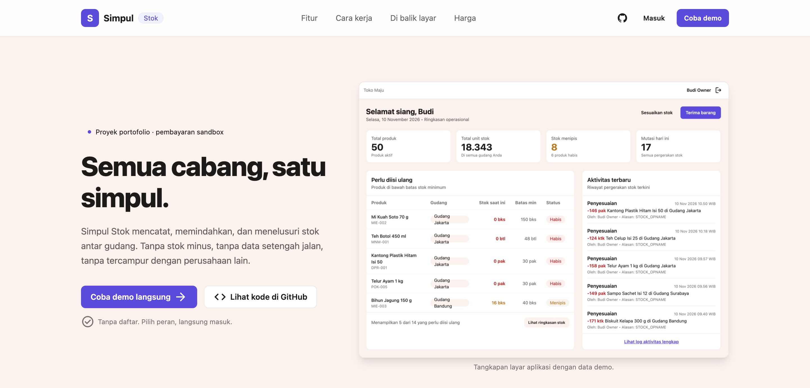

# Muhammad Adharul Imron

**Junior Full Stack Developer** · Building reliable apps, from requirements to production.

Hacktiv8 Fullstack JavaScript Immersive graduate (Honors, 98/100), with 3+ years in data analytics, growth, and product roles at Moladin, Mekari, Paper.id, and Ruangguru. I care about the parts users never see: stock that never goes negative, data that stays isolated per company, and requests that are safe to retry.

## Featured projects

### Simpul Stok: multi-tenant inventory SaaS

Live demo: [simpulstok.adharul.my.id](https://simpulstok.adharul.my.id)

Code: [simpul-stok-express](https://github.com/i-adharul/simpul-stok-express) (Express 5, Sequelize, PostgreSQL, Zod, JWT, React)

- Atomic stock transfers using database transactions and row locking
- Tenant isolation by scoping every query to the user's organization
- Idempotent stock updates and an append-only stock history
- 2,600+ automated tests (Jest, Supertest)

### Bloom Bash: in-store tablet game and CMS (client project)

Offline-first tablet game and role-based CMS for a Wacoal Bloom launch activation, from client meetings to sign-off.
Next.js, TypeScript, MongoDB, PWA/IndexedDB, Gemini API. Code is private; walkthrough available on request.

### More projects

- [sp500-live-chart](https://github.com/i-adharul/sp500-live-chart): live S&P 500 candlestick charts over WebSocket, with Google sign-in and Gemini-powered insights (React, Express, Socket.IO).
- [pejuang-umr](https://github.com/Group-Project-Idn/pejuang-umr): hex-board life simulation game about surviving 12 months on a Jakarta minimum wage, with AI reflections (TypeScript monorepo, group project).
- [tiket-stays](https://github.com/i-adharul/tiket-stays): accommodation listing site with an admin CMS (React, Tailwind CSS).

## Tech stack

- **Core:** JavaScript, TypeScript, Node.js, Express, PostgreSQL, Sequelize, React, Next.js, Tailwind CSS
- **Also used:** MongoDB, Redis, GraphQL, React Native, Jest, Supertest, Vitest, Zod, JWT, AWS EC2, Vercel, Supabase
- **Data background:** SQL, Python, BigQuery, Google Cloud Platform, Looker, Tableau

## Contact

[LinkedIn](https://linkedin.com/in/adharul-imron) · [i.adharul@gmail.com](mailto:i.adharul@gmail.com) · [Data portfolio](https://i-adharul.github.io)
